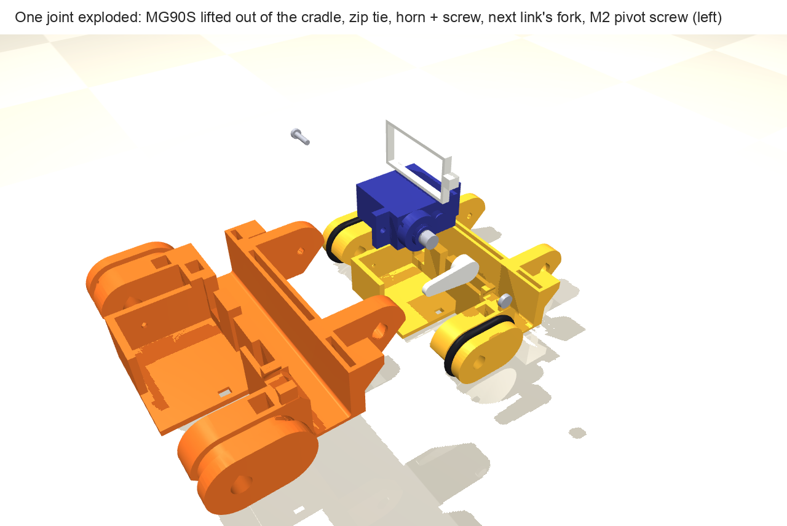
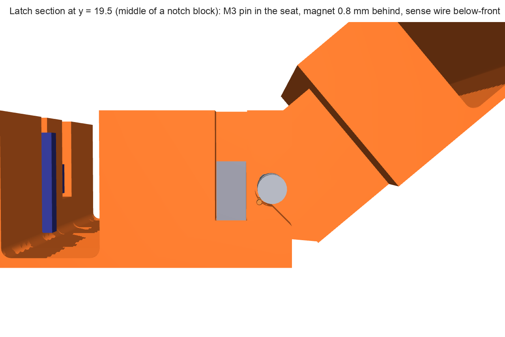

# Ouro mechanical design

You print nine parts: seven links, a tail and a head. Each one carries an MG90S servo in a cradle at the front and a fork at the rear that the previous servo drives. Eighteen O-rings make the treads, two magnets in the tail and two steel screws in the head make the latch that closes the strap into a wheel, and the electronics tape onto the backs.

Two choices shape every part. First, each link is two blocks joined by a 1.0 mm PETG leaf spring. Each link gives about 7° at a firm push, so the strap has some give built into every segment. Second, the design works with slop. Hobby servos have backlash and clones vary, so the servo sits in its cradle with about 0.3 mm of play, the pivot arm swings free on its screw, and a printed end stop at 89.5° catches each joint on plastic before backlash and leaf flex can push it into the electronics. The simulation is trained with the same hard stop.

The parts are new designs, so print the test coupon first and check it against your servos before you print the set.

---

## What you're printing

| Part (`cad/out/`) | Qty | Segment | Printed mass | Print time (est.) |
|---|---|---|---|---|
| `coupon.stl` | (1) | **Print first.** One cradle and one fork, to check servo and horn fit. | 7.5 g | ~30 min |
| `link.stl` | 4 | s1, s2, s6, s7 (every link and the head also carry the +90° end-stop toe, see below) | 14.4 g | ~1 h each |
| `link_s3_battery.stl` | 1 | s3: link + battery fence with two tie windows | 16.2 g | ~1 h 5 min |
| `link_s4_esp32.stl` | 1 | s4: link + raised ESP32 pad (wire-channel walls raised to match) | 15.2 g | ~1 h |
| `link_s5_power.stl` | 1 | s5: link with solid front crossbar, no channel (the power board covers it) | 15.0 g | ~1 h |
| `tail.stl` | 1 | s0: cradle at the front; notches, magnets and a second pair of treads at the rear | 19.5 g | ~1 h 20 min |
| `head.stl` | 1 | s8: fork at the rear, two latch-pin forks at the front | 15.8 g | ~1 h 5 min |

The full set is about **139 g** plus the coupon, against a 130 g budget. Expect **9 to 10 h** of printing. The masses are solid volume × 1.27 g/cm³ × 0.55 (PETG, 3 walls, 15 % infill), and the times come from mass at about 14 g/h, so weigh your first link and trust your slicer's time over these.

The end-stop toe adds 0.8 g to each link. The tail is the heaviest part because of the second pair of O-ring treads under the latch corner, which matches the tread `k0` in the sim. The sim's `s0` mass of 30 g assumes a 12.5 g tail print; with this tail it should be about **36 g**.

### Print settings

Print every part **belly down exactly as exported** (the STL's lowest face, z = -8, goes on the bed), with **no supports and no brim**.

| Setting | |
|---|---|
| Material | PETG. Not PLA: the leaf springs fatigue in PLA. |
| Nozzle and layers | 0.4 mm nozzle, 0.2 mm layers, 3 walls, 4 top and 4 bottom layers, 15 % gyroid |
| First layer | Turn elephant-foot compensation on (0.1 to 0.15 mm), or the 1.0 mm leaf spring prints thicker and stiffer. Stiffness goes with thickness cubed: 0.9 mm gives 0.90 N·m/rad and 1.1 mm gives 1.65. |
| Cooling | 30 to 50 % fan. Bridges are 3 mm or shorter. |

The lower arcs of the R6.5 groove core and the R8 tread flange (|y| > 33) print as small droops near the bed. They are round on purpose because the O-ring needs them round. Two features are thinner than 0.8 mm by design and your slicer will drop them: the 0.2 mm wedge where the latch-wire groove breaks into the pin seat, and a 0.15 mm² sliver where the rear-tab slot cuts the leaf fillet. Both are fine.

Print two spare links. Fatigue life of the leaf at 14 to 16 MPa in printed PETG is unknown.

---

## Print the test coupon first

The cradle and the horn recess are sized for a datasheet MG90S and a 1.7 mm horn plate. Clones vary by ±0.3 to 0.5 mm, and horns vary more. The coupon (one cradle and one fork, 30 minutes) tells you whether your servos fit before you commit 9 hours of printing.

Before printing anything, measure one servo with calipers. **The four numbers that matter most:**

1. case thickness
2. tab underside height
3. spline top height
4. horn plate thickness and length

Compare them with the values in [MG90S parameters](#mg90s-parameters) below. If your horn is longer than 15.5 mm from the centre to the tip, cut it down with flush cutters (the recess runs into the crossbar).

Then print the coupon. The servo should drop in with about 0.3 mm of play all round, and the horn should press into the fork recess and stay there. If it doesn't, edit the parameters in `cad/make_parts.py` and regenerate the parts (see [Regenerating the parts](#regenerating-the-parts)). Expect one reprint.

---

## One joint, step by step

A joint is the servo in link N's front cradle, driving link N+1's rear fork.

- **Horn arm (+y):** the horn presses into a recess on the arm's inner face.
- **Pivot arm (−y):** turns on the servo's own 2 mm screw, which threads into a boss on link N.



1. **Centre the servo.** Command 1500 µs (see the [Build plan](build.html)) and leave it there.
2. **Horn into the fork.** Press the single-arm horn into the recess on the inner face of link N+1's horn arm, with the hub facing the servo side. A small drop of superglue on the plate edge is fine. The fork holds the horn axially once assembled, so the glue only stops it rattling.
3. **Servo onto the horn, outside the cradle.** Hold the servo between the two fork arms and slide the spline into the horn hub along the shaft axis. There is 1.2 mm to spare past the pivot arm, so it goes in square. Choose the spline tooth that makes link N+1 point straight along the servo body at 1500 µs. One tooth off is 15°. Drive the horn screw through the hole in the horn arm.
4. **Drop the servo, with link N+1 hanging on it, into link N's cradle from the back.**
   - The rear tab goes into the slot in the front crossbar, and the front tab rests on the post.
   - The pivot arm goes down outside the pivot boss, and the horn arm goes outside the floor.
   - The lead leaves the rear of the servo into the leaf-spring gap.
5. **Pivot screw.** Drive one of the servo's 2 mm mounting screws through the hole in link N's −y cheek. It goes through the pivot arm and into the boss pilot. **Stop as soon as the head touches the arm, then back off a quarter turn.** The arm must swing freely; it has 0.15 mm of axial play. Tighten it and you add friction the sim does not have.
6. **Zip tie (2.5 mm):**
   - Thread it through the slot in the floor just past the servo top (the shaft end), tail end first.
   - Run it along the recess under the belly, up the outside of the wall at the servo's bottom end, and back over the servo.
   - Pull it tight with the **ratchet head at the shaft end** (+y, below the horn), never on top. On top, it sits under the boards on s4 and s5.
   - Cut the tail flush. The tie sits 0.35 mm proud of the belly and the treads stand 1.0 mm proud, so it clears the desk.
7. **Check by hand.** Bend the joint down to −69°: nothing should touch except the horn turning. Then **fold the joint up by hand: it must stop on plastic at 90° with the electronics untouched.** The two toes on the next link land flat on the tops of this link's cheeks. Then press the two halves of each link together: the leaf spring should give about 7° at a firm push.

**Measure the leaf spring on your first link.** Hang 150 g at 100 mm from the joint and read the angle. 7° is on target. Printed PETG ranges from 1.8 to 2.2 GPa and layer adhesion matters, so your number can differ from the design value.

**Check the end stop on your first printed pair.** It must land on the cheek tops at 89° to 90°, and the 45° toe must not crack when the servo stalls against it.

---

## The other joints and the O-rings

Build the remaining joints the same way.

- The horn screw and the pivot screw can both be reached later with a 3 mm screwdriver through the holes in link N's cheeks, so you can re-index a horn without taking the joint apart.
- On s4 and s5 the board sits over the servo. Swapping that servo means peeling the board off first.
- Leave a 5 mm S-loop in each servo lead where it crosses its own leaf-spring gap, so the lead does not stiffen the spring.

**O-rings: 18 of them, 18 × 2.5 mm nitrile.**

- Two go on the front of every link s0 to s7, plus two on the rear of the tail. The head has none.
- Roll each one over the outer R8 flange into the groove. That is a 24 % momentary stretch, easy by hand. Seated, it is stretched 7.6 % on the inside and stands 0.92 mm proud of the plastic around the joint.
- Wipe the rings and the desk with isopropyl before a rolling run.

---

## The magnet latch

The tail carries two magnets in notches. The head carries two steel screws as latch pins. When the strap rolls up, the pins drop into the notches, the magnets pull them home, and each pin closes a sense circuit so the robot knows it has become a wheel.



**Magnets (two 6 × 3 mm discs, in the tail):**

1. Check polarity first. Stack both magnets on a screwdriver and mark the outward face of each, so both point the same way.
2. Put a drop of superglue in each pocket and push the magnet down from the back.
3. 0.8 mm of plastic separates each magnet from the seat. With the pin pulled home, the gap from pin to magnet is 0.9 mm.

**Latch pins (two M3 × 25 zinc-plated steel screws, in the head; not stainless):**

- Solder a wire to each screw head before driving it in: left pin to GPIO 27, right pin to GND (see [Electronics](electronics.html)).
- Drive each one from outside through the outer fork and the inner fork. They self-tap into a 2.6 mm hole. The pan head sinks flush into the outer fork, and the tip ends 5 mm from the centreline.

**Latch-sense wires (in the tail):**

- Lay a bare 0.5 mm tinned copper wire in the groove across the lower front of each pin seat, then up the groove on the outer face of the block. Glue the ends on the back.
- Join the two notch wires with an insulated wire across the tail's back. Use one wire per notch: a single wire straight across the middle would pass through the head's inner forks.
- When a pin is pulled home by the magnet it bears on its wire. The wire stands 0.15 mm proud, which gives a 0.07 mm overlap with the pin, so test continuity on your build.

**Pull-off test:** follow the step in the [Build plan](build.html). The magnet pull through 0.8 mm of plastic plus the 0.25 mm gap is an estimate, so this test is where you find out. If the latch is too strong, shim each magnet deeper with paper before gluing. The seat funnel opens at 45° to ±4.5 mm, so the pin is steered in from that far off-axis. Watch the first few closures: the fit check covers the seated pose, and the swing into the funnel is something you confirm on the real robot.

---

## Where each board mounts

Everything sits on the back, which is the inside of the wheel. Use 1 mm foam tape, zip ties and hot glue, with no extra screws.

**No board may touch both halves of a link.** Fix each one to one block, the front or the rear, and keep it at least 2.5 mm clear of the other, checked with the leaf flexed ±10°. Never tape wires across a leaf spring.

| Segment | What | How | Where (link frame, mm) |
|---|---|---|---|
| s3 | 2S 450 to 500 mAh LiPo (46 × 25 × 12.5 assumed) | **Stood on its long edge**, foam-taped to the front face of the fence on the rear crossbar. Two zip ties go through the fence windows, under the pack and over the top. The lead leaves the pack's −y end. | x 16.1 to 28.6, y −39.6 to 6.4 (overhangs the −y side), z 11 to 36 |
| s3 | XT30 pair and F1 polyfuse (in heat-shrink) | **Lying flat on top of the standing pack**, along y, taped to it | x 16.1 to 28.6, y −33 to −8, z 36 to 42 |
| s4 | ESP32 DevKit 30-pin | Header pins **cut flush under the black spacers**, with wires soldered to the pin stubs on top. Foam-taped (PCB underside) onto the pad and channel walls. Fixed to the front block; the rear spacer row overhangs the rear block 2.6 mm clear. USB end at −y, module at +y. | x 10.8 to 39.1, y −17.5 to 34, PCB underside z 13.1 |
| s4 | GY-521 (mid IMU) | Foam-taped on the ESP32 module's metal can, toward its rear end. X toward the head and Z out of the back, as the sim assumes. Off the antenna end. | x 11.3 to 32.5, y 6.6 to 23.0, top z 22.0 |
| s4 | Battery pair (22 AWG red/black, twisted) | Taped along the −y edge of the front block, clear of the ESP32 | x 27.6 to 40, y −31 to −26, z ≤ 10.6 |
| s5 | Power board, 66 × 20.5 mm (26 × 8 holes), on 1 mm foam on the front block | Column 1 at y −31.7, column 26 at y +31.8. Row A faces s4. Layout per `perfboard.svg`. | x 19.0 to 39.5, board top z 10.6 |
| s5 | Two Mini560 (29 × 18 × 5.4), stacked, 18 mm side along the body | Columns 2 to 12; U3 on the board, U1 on top of U3 | y −30.5 to −1.5, top z 23.4 |
| s5 | INA219 flat (no screw terminal), with C2 (**220 µF**, 6.3 × 11) lying on it | Columns 14 to 22 | y 0 to 23, top z 21 |
| s5 | R1/R2 standing | Column 1, rows C to F | top z 20.5 |
| s5 | **3 × 8 servo header J1** with the eight plugs | Columns 24 to 26, rows A to H | y 24.4 to 33, plug tops z 27.1, wires bent flat by z 29 |
| s8 | GY-521 (head IMU) | Foam-taped on the head's front block | x 21.6 to 38, y ±10.6 |
| s0 to s7 | Servo leads | Open channel with snap lips on each front crossbar at y 24.5 to 31.5: x 27.5 to 31 on s3 and s4, x 30 to 34 on the other links. On the plain links the top rear edge of the front crossbar is chamfered 2.4 mm at y 23.4 to 33, which gives s5's servo-plug wires room at j6. A slack loop of 15 mm crosses each joint. The leads never cross a leaf gap tight. | |

Wiring and soldering for these boards are on the [Electronics](electronics.html) page.

### Why it is laid out like this

The back is the inside of the curl. At +90°, a neighbouring link stands up as a wall at x = 8 and x = 40, so each back has a 32 mm window. Everything above is placed to fit that window with the joints folded.

- **Battery standing up.** A pack lying flat (25 mm along the body) on s3 cannot share the window with the ESP32 on s4 when j4 is at +90°. Standing on edge, it takes 12.5 mm.
- **Power board 20.5 mm deep along the body (x 19.0 to 39.5).** It has to clear the ESP32 on s4 when j5 is at +90° and s6 when j6 is at +90°.
- **Mid IMU at the rear of the module can, kept below y 23.8.** That keeps it clear of the battery's y band when j4 is at +90°, the INA219 at j5 +92°, and the servo-plug wires at j5 +90°.
- **XT30 and fuse on top of the pack, not on the s3 front block.** The front-block spot (x 29 to 39, y −33 to −8) lies inside the ESP32's y band, so it is hit from j4 = 75°. The battery would also hit it as s3's leaf flexes. If you see the front-block position anywhere else in the docs, use the on-top position given here.
- **Wire channel on s6 (and the other plain links) at x 30 to 34.** At x 27.5 to 31 it would meet the servo-plug wires (z 29) on s5 at j6 = 87°.

### Keep the stacks low

The electronics clear the end stop by only 2.5° to 3° on j4 to j6 (rigid links). Anything taller than the dimensions above eats that margin:

- **Battery size.** Packs sold as 2S 500 mAh range from 47 × 25 × 10 to 56 × 28 × 13. Anything thicker than 12.5 mm in x moves the front of the battery past 28.6 mm and eats the j4 margin. A longer pack overhangs further at −y, which is fine up to y = −40.
- **Foam tape.** Real foam tape ranges from 0.8 to 1.6 mm. Thicker tape raises the s4 stack and costs about 2° of j4 margin per millimetre.
- **Servo wires.** Keep the plug wires on s5 bent flat by z 29.
- **Wire bundles and hot glue.** The bundle thickness in the channels, slack loops squashed inside the curl and hot glue are not in the model. The fit of the 45° snap lips on the wire channels is a best estimate too.

After mounting, fold each joint to the stop by hand again and look at j4, j5 and j6.

### Servo lead lengths

With the header on s5, the MG90S lead taken as 240 mm, and 15 mm of slack per joint crossed. Measure your leads; these numbers assume 240 mm and the routing above.

| Servo | In segment | Length needed | Extension |
|---|---|---|---|
| M1 | s0 | 387 mm | **20 cm** (53 mm spare) |
| M2 | s1 | 324 mm | **15 cm** (66 mm spare) |
| M3 | s2 | 261 mm | **15 cm** (129 mm spare) |
| M4 to M8 | s3 to s7 | 72 to 198 mm | none; at least 42 mm spare |

---

## Design reference

### Regenerating the parts

Everything on this page comes from `cad/` and can be regenerated. If your servo measurements differ from the parameters below, edit the top of `cad/make_parts.py`, rebuild, and re-run the fit check before printing.

```
cd cad
python make_parts.py     # parts -> out/*.stl, prints masses
python check_fit.py      # all fit checks, PASS/FAIL table, out/check_fit.txt (about 25 s)
python export.py         # out/assembled_*.glb/.stl and out/render_*.png
```

| File | What it is |
|---|---|
| `cad/make_parts.py` | The printed parts as parametric manifold3d CSG. Every MG90S-dependent number is at the top. |
| `cad/components.py` | Dummy solids of every bought part (MG90S, horn, ESP32, GY-521, INA219, Mini560, LiPo, capacitor, screws, magnet, O-ring) and where their numbers come from. |
| `cad/assembly.py` | Where every bought part sits on every link, and the joint-chain maths. |
| `cad/check_fit.py` | The fit checks below. |
| `cad/export.py` | STL/GLB/PNG output. |
| `cad/out/` | Generated files. The printable parts live here; any older reference to `cad/*.stl` means these. |

### MG90S parameters

From the TowerPro-style table (A 32.5, B 22.8, C 28.4, D 12.4, E 32.1, F 18.5) read together with the Adafruit/TowerPro drawing (32.5 across the tabs, 35.5 tall with the horn). Heights are from the case bottom.

| Parameter (`make_parts.py`) | Value | Clone spread seen | What it drives |
|---|---|---|---|
| `S_LEN` case length | 22.8 | 22.2 to 23.0 | pocket length |
| `S_THK` case thickness | 12.2 (12.4 in one table) | 11.8 to 12.6 | pocket width; floor is only 1.65 mm under it |
| `S_H` case top | 22.7 | ±0.5 | pocket |
| `S_SHAFT` shaft to front end | 6.0 | ±0.3 | where the case sits relative to the joint axis |
| `S_TAB_Y` tab underside | 16.0 (F 18.5 minus 2.5) | ±0.5 | front post height, rear tab slot |
| `S_TAB_L` tab overhang | 4.85 | 4.5 to 5.0 | tab slot length |
| `S_SPLINE_TOP` spline top | 32.1 | ±0.5 | **where the horn arm sits (`HORN_IN`)** |
| gear hump / boss | R6.1 to 26.7, boss R3.6 to 28.4 | ±0.5 | must stay under the horn hub (0.5 mm gap) |
| horn plate (`HORN_T`, `HORN_W0`, `HORN_W1`, `HORN_LEN`) | 1.7 thick, 7.0 to 4.0 wide, 15.5 from centre to tip | horns differ a lot | horn recess in the fork |

The pocket clearance is 0.25 mm.

### Leaf spring and stress

- k = 1.24 N·m/rad from beam theory (E 2.1 GPa, 10 mm leaf with 1 mm root fillets). The root fillets lower the stress concentration at the root.
- At 0.15 N·m (servo stall): 6.9° and 13.6 MPa nominal, about 16 MPa at the fillet.
- Stiffness goes with thickness cubed: 0.9 mm gives 0.90 N·m/rad, 1.1 mm gives 1.65. This is why elephant-foot compensation matters.
- Printed PETG ranges from 1.8 to 2.2 GPa, so measure yours with the 150 g at 100 mm test (7° is on target).
- Fatigue at 14 to 16 MPa is unknown for printed PETG. Keep spares.

### The +90° end stop

A toe on each side of every link's rear crossbar (|y| 26 to 33, face at x = 7.95, 45° underside) lands flat on the previous link's cheek tops (x 40 to 43, kept solid). Contact is at 89.5°, about 21 mm² per side, plastic on plastic, on every joint.

The MG90S has no hard stop of its own, and backlash plus leaf flex let loads push a joint 10° or more past its command. With soft joint limits in the sim, the startle behaviour flung j6 to 97° and hit the s5 plugs. The printed stop exists to catch that.

**Servo command limit: +86° (1.50 rad).** The printed stop is at 89.5°, so 4° of backlash still lands on plastic, not on electronics.

**What the stop does not cover.** It limits the servo-driven rotation, between this link's front block and the next link's rear block. The first electronics contacts on j4 to j6 involve the next link's *front* block:

- j4: the s4 ESP32 against the s3 channel
- j5: the s5 plugs against the s4 ESP32
- j6: s6's front crossbar against the s5 plug wires

The next link's leaf spring can still swing that front block about 2.5° to 3° past the stop. That takes roughly 0.05 to 0.065 N·m on that leaf, against 0.15 N·m at servo stall. So a hard knock or a stalled curl can still press on those parts. The proper fix would be lower stacks on s4 and s5, not a stiffer leaf. See [Limits](risks.html).

### Design details

These are the features that make the parts assemble, print without supports and behave like the sim:

- **Horn arm position.** The arm's inner face is derived from `S_SPLINE_TOP` (`HORN_IN` = 14.5), so the MG90S spline (which reaches y = 15.1) clears the 2.2 mm hole in the horn arm. The horn plate sits in a recess with a 45° roof.
- **Horn recess** is cut after the fork is joined to the crossbar, so the horn tip is never buried in the crossbar.
- **Screwdriver access.** A screw-head and driver hole runs through the −y cheek and tread to the pivot screw, and the horn-screw hole through the +y cheek is 4.8 mm.
- **Zip-tie lane** runs behind the MG90S gear humps, with the floor slot past the idler hump. The tie recess is 0.75 mm, leaving a 0.9 mm floor.
- **Pivot boss** runs down to the bed.
- **Head latch forks** run to the bed with a 45° front.
- **Tail notch** has a 45° funnel roof.
- **Round knuckles** of the arms and cheeks have a 45° chamfer on their bottom quarter.
- **Horizontal holes** are all teardrops.
- **Leaf spring** is 10 mm long with root fillets: 1.24 N·m/rad.
- **Rear tread pair on the tail** under the latch corner, matching the sim's `k0`, with cheeks kept outside the head fork's swept zone.
- **One latch-sense wire per notch**, joined across the back, so no wire runs through the head's inner forks.
- **Mounts** for the battery, boards and IMUs, plus wire channels: the s3 fence, the s4 pad and the link variants above.
- **+90° end stop** on every joint, described above.

### Fit-check results

`python check_fit.py` checks the printed parts against dummy bought parts built from datasheet numbers (full log in `cad/out/check_fit.txt`). Interference is the boolean intersection volume; anything under 0.5 mm³ counts as zero. All checks pass.

| Check | What it confirms |
|---|---|
| a servo in cradle | 0.0 mm³ servo/link, tie/link, tie/servo. The servo is retained in all six directions with ≤ 0.30 mm play: floor, walls, rear-tab slot, front post, tie (0.05 mm). Pitch about the shaft is stopped by the floor and tie. Tie slot 3.0 × 2.2 mm for a 2.5 × 1.1 tie. |
| a2 screwdriver paths | A 3 mm driver and screw head reach the horn screw (+y) and pivot screw (−y) through the cheeks: 0.00 mm³. |
| b joint sweep, plain pair | First plastic contact at **89.5°**, the end stop (toe on cheek, 88.5° to 90° required). Nothing touches from −69° to +88°; minimum gap 0.36 mm. Horn in recess 0.0 mm³. |
| c latch | No interference over a 0° to 90° corner angle. 0.25 mm pin play. The pin bears on the sense wire when home (0.49 mm³ overlap). |
| d joints with payloads | All eight joints (tail–s1 through s7–head), with the final electronics fitted, first touch at 89.5° on the plastic stop, with nothing else touching. |
| d1b electronics margin | Electronics first contact − 90°, rigid links: j1 none, j2 none, j3 +7.5, **j4 +2.5, j5 +3.0, j6 +2.5**, j7 none, j8 +54. Below −69°: nothing before −120°. |
| d wheel + strap | Closed 9-gon (closure error 0.000 mm) and flat strap, everything fitted: no interference. Free height above each back in the closed wheel: 19 to 97 mm. |
| d3 replay of the simulated act | The real parts driven through the joint angles in `visual/traj.json`, recorded from the sim with the hard +90° stop and the policies trained on it: crawl, learned bite, learned roll and startle, no interference in any frame. See [Simulation and RL](learning.html). |
| e O-ring | 7.6 % stretch on the inside, 0.92 mm proud, 24 % to pass the flange. |
| f leaf spring | k = 1.24 N·m/rad; 6.9° and 13.6 MPa nominal (about 16 at the fillet) at 0.15 N·m. Nothing bridges the spring: each link splits into 2 pieces with the leaf removed, and nothing touches across the gap at ±10° of flex. |
| g printability | No overhang beyond 50° above the first 2 mm. Bridges ≤ 3.0 mm. No wall or plate under 0.8 mm except the two by-design spots under [Print settings](#print-settings). |
| h lead routing | M1 20 cm, M2 and M3 15 cm extensions; the rest reach. |

### What to confirm on your first build

The fit check covers geometry. These come down to your parts and your print:

1. **Servo and horn fit.** Print the coupon.
2. **Leaf stiffness.** 150 g at 100 mm should give about 7°.
3. **End stop.** Lands at 89° to 90° on the cheek tops, toe survives a stall.
4. **Latch.** Pull-off strength, sense-wire contact, and the pin finding the funnel as it swings in.
5. **Electronics margins on j4 to j6.** Fold each joint to the stop with everything mounted.
6. **Lead lengths.** Measure your servo leads against the 240 mm assumed above.
